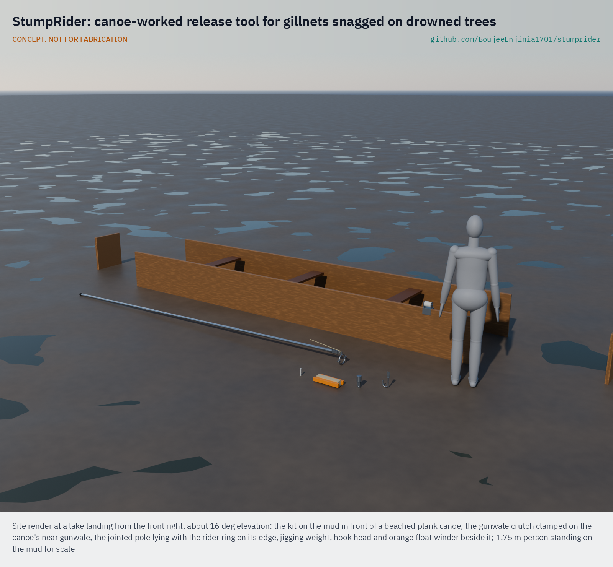
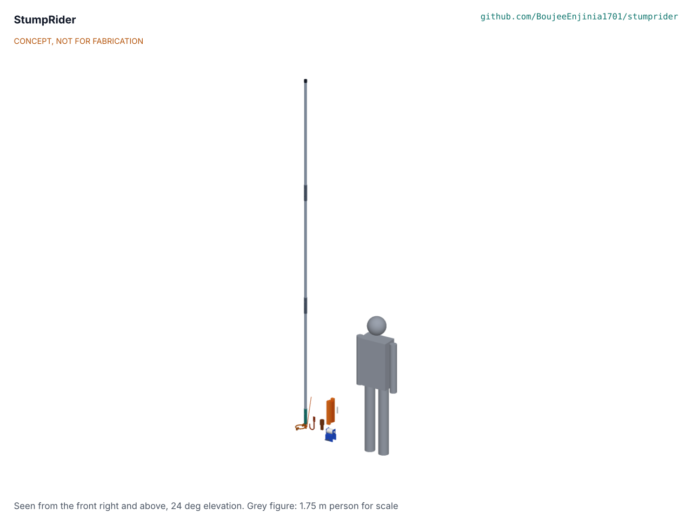
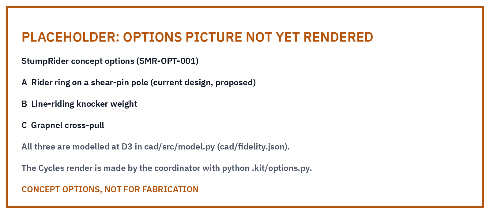
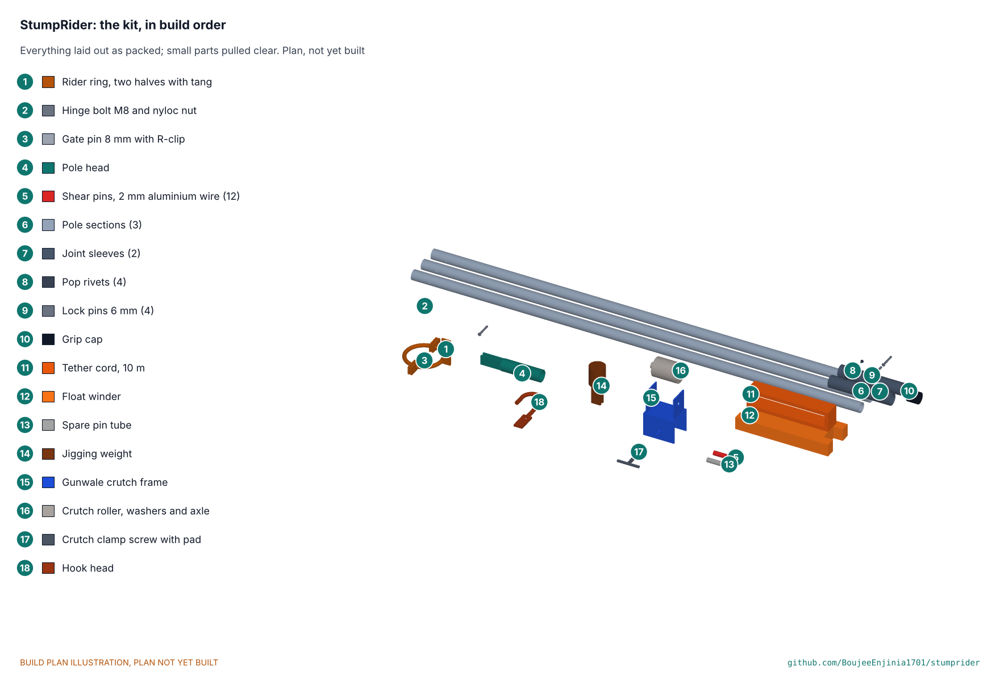

# StumpRider

    [](https://github.com/BoujeeEnjinia1701/stumprider/actions/workflows/reuse.yml) [](https://archive.softwareheritage.org/browse/origin/?origin_url=https://github.com/BoujeeEnjinia1701/stumprider) [](https://doi.org/10.5281/zenodo.23132236)

**Area:** Food and water security · **TRL:** 3 of 9 (proof of concept on paper) · **Stage:** P3 (design outputs) · **Value-engineering target:** USD 2,000 for the prototype work (estimated cost of the constructable design USD 299.50 for three kits and a bamboo pole) · **Difficulty:** 2 of 5

Frees gillnets snagged on submerged trees from the canoe so children are not sent to dive.



[Interactive 3D model](media/viewer.html) · [Concept blueprint (PDF)](media/concept-blueprint.pdf) · [General arrangement SMR-DWG-001 (PDF)](cad/drawings/SMR-DWG-001.pdf) · [STEM check](docs/01b-stem-check.md) · [Concept options](docs/02a-concept-options.md) · [User requirements](docs/03a-user-requirements.md) · [Product requirements](docs/03-requirements.md) · [Traceability](docs/03b-traceability.md) · [Calculations SMR-CAL-001](docs/04-calcs/01-sizing.md) · [Prototype build plan](docs/05-build-plan.md) · [Decisions](docs/06-design-decisions.md) · [Review note](docs/REVIEW.md)

> CONCEPT, NOT FOR FABRICATION. StumpRider is a TRL 3 design on paper: it has not been built or tested, it is not certified equipment, and it never replaces a life jacket.

## Concept rationale

StumpRider is a release tool worked entirely from the canoe. A ring clips around the net line and slides down it onto the snag. The fisher pushes and works the ring with a pole until the net lifts clear of the branch. A shear pin in the pole head breaks at a set load, so a hard pull cannot capsize the canoe or tear the mesh; the pin is replaced and the fisher tries again from a different angle.

The design is deliberately simple: a hinged steel ring, a three-piece pole, a soft aluminium pin and some cord, all of which a village workshop can make and repair. The aim is not to improve the catch but to remove the one task that puts a child underwater. It is published as an open engineering reference so that NGOs, fisheries officers and boat builders can make it locally.

## Burning platform

Lake Volta in Ghana was formed over a flooded forest. It holds about 14 million cubic metres of submerged hardwood, and many trunks lurk just below the surface, where they snag fishermen's nets and hole canoes; stumps were the leading cause of documented boat accidents on the lake from 1990 to 2011, at 38 % ([Underwater timber harvesting on the Volta Lake, WMU](https://commons.wmu.se/cgi/viewcontent.cgi?article=1009&context=all_dissertations)). Child labour studies list the task directly: children dive into deep water to disentangle fishing nets from tree stumps, and small children have drowned doing it ([Analytical study on child labour in Lake Volta fishing, ILAB](https://www.dol.gov/sites/dolgov/files/ILAB/CHILD%20LABOUR%20IN%20VOLTA%20LAKE%20FISHING%20STUDY%20REPORT%20-%20FINAL%20REPORT.pdf)).

A 2024 prevalence study found that 15 % of children working in Lake Volta fishing reported diving underwater to retrieve nets, 37.7 % were likely victims of trafficking, and 5.1 % of parents and caregivers knew of a child who had died working on the lake ([IJM, 2024](https://ijmstoragelive.blob.core.windows.net/ijmna/documents/studies/2023-Fishing_Prevalence_Study_Report.pdf)). Enforcement and rescue matter most, but as long as nets snag, somebody is sent down. A tool that frees the net from the surface takes away the reason to send a child.

## Where it could be used

### By industry

| Industry | Use |
| --- | --- |
| Inland capture fisheries | Freeing gillnets and set lines snagged on drowned trees in reservoirs and lakes |
| Child protection and anti-trafficking programmes | A practical tool to hand out alongside rescue and awareness work, so boat owners have no excuse to send a child to dive |
| Fisheries extension and co-management | Safe-practice kits distributed through fisher associations and landing-site committees |
| Reservoir and dam operators | A low-cost measure for fishing communities on impoundments where forest was left standing |
| Recreational and research netting | Recovering survey nets and sampling gear from snag-rich water without divers |

### By country or region

| Country or region | Why it matters there |
| --- | --- |
| Ghana (Volta Lake) | About 14 million cubic metres of submerged trees snag nets and hole canoes ([WMU](https://commons.wmu.se/cgi/viewcontent.cgi?article=1009&context=all_dissertations)), and 15 % of children in the lake fishery report diving to retrieve nets ([IJM, 2024](https://ijmstoragelive.blob.core.windows.net/ijmna/documents/studies/2023-Fishing_Prevalence_Study_Report.pdf)). |
| Ghana (national) | An ILAB-funded study estimated over 49,000 children involved in fishing in Ghana, 87 % of them boys ([ILAB](https://www.dol.gov/sites/dolgov/files/ILAB/CHILD%20LABOUR%20IN%20VOLTA%20LAKE%20FISHING%20STUDY%20REPORT%20-%20FINAL%20REPORT.pdf)). |
| Zambia and Zimbabwe (Lake Kariba) | A large inshore gillnet fishery on a dammed reservoir, with around 1,200 fishers on the Zambian side by 1999 ([FAO](https://www.fao.org/4/y5056e/y5056e03.pdf)); whether snags drive diving there is an open question. |
| Low- and middle-income countries generally | Small-scale fisheries produce about 99.7 % of inland fisheries output and about 60 million people work in small-scale fishing ([Nature](https://www.nature.com/articles/s41586-024-08448-z)), so a hand tool that works in snag-rich water has a wide potential reach. |

## What sparked the idea

The idea came from the story of Foli, a boy enslaved on Lake Volta who was forced to dive into dark, murky water to untangle nets that caught on branches below the surface, even though he could not swim, until IJM social workers and local authorities took him off the canoe and arrested the boat master ([IJM](https://www.ijm.org/stories/foli)). The net had to come free somehow; the question was whether it could come free without a child going under.

## Problem

On lakes with drowned forests, gillnets catch on submerged trees and boat masters send children down to free them, sometimes children who cannot swim. Fishers have no simple tool that frees a snagged net from the canoe. Design with, not for: the requirements must be confirmed with a child-protection partner and fisher crews (none approached yet).

Full problem statement: [docs/01-problem.md](docs/01-problem.md)

## Concept

A hinged ring of 12 mm steel bar, 100 mm inside, clips round the net line and is pushed down it onto the snag by a three-section aluminium pole, 4.18 m from the top hand to the ring. The crew slackens the line and the operator lifts the net off the branch: a net hooked over a branch needs 81 to 126 N on paper. The pole head grips the ring's tang only through a 2 mm soft aluminium shear pin (302 N nominal, 256 to 347 N), so a hard pull or push breaks the pin before a steady pull can heel the 8 m design canoe more than 3.4 deg. A hook head pins into the same fork for nets wrapped round a branch; a jigging weight pins onto the tang for snags beyond the pole; a 10 m tether on a floating winder brings everything back; a clamp-on crutch with a roller guides the line over the gunwale (SMR-CAL-001).



Full design precis: [docs/02-concept.md](docs/02-concept.md)

## STEM check

Twenty-seven claims are checked (SMR-STM-001): 15 are within known science, 11 are plausible and need TRL 4 data (the pin wire's band, the freeing pull on real nets, the canoe's measured stability, corrosion and the bamboo treatment), and 1 fails with a fix proposed to Amish: the hook head with the net caught on its tip leg is under the rule that every part is twice as strong as the pin (O10; the gusset Amish approved on 2026-10-25 was found not to reach the straight shank, so it is back with him). A quick pull held just under the pin can heel the canoe about 6.5 deg; since Amish's decision O6 the 5 deg limit is static and the operator lifts steadily, never with a jerk. Two details were fixed in this session under Amish's standing instruction: the hook head's J is now 12 mm bar (F1), and option C's grapnel tines 14 mm (F2). An independent reviewer recomputed the calculation note and its findings are recorded in the check.

## Concept options



Option A, the rider ring on a shear-pin pole (the current design, weighted score 120), was chosen over option B, a line-riding knocker weight (134), and option C, a grapnel cross-pull (109). B leads the weighted sum on cost and simplicity but scores 1 of 5 on freeing the net, the reason the tool exists; Amish chose option A on 2026-10-25 (SMR-OPT-001, SMR-DDR-005). All three are modelled in detail (D3): 77, 55 and 42 parts. The options picture is rendered by the coordinator; until then the file is a labelled placeholder.

## Key components

Rider ring of 12 mm galvanised steel bar in two hinged halves with an M8 hinge bolt and an 8 mm gate pin; pole head (38 mm socket, end plate and fork cheeks); 2 mm soft aluminium shear pins from one calibrated reel; three 1.45 m pole sections of 32 x 2 aluminium tube with riveted sleeves and 6 mm lock pins (or three treated bamboo culms with steel ferrules in the local variant); 10 m polyester tether on an orange foam float winder; jigging weight; hook head; clamp-on gunwale crutch with an HDPE roller.

## Building the prototype

The [prototype build plan](docs/05-build-plan.md) (SMR-BLD-001, plan, not yet built) is written for a village smith: making sketches for the made parts and the bamboo variant pole (SMR-DWG-101 to 112), close-ups of eleven joints and a picture for each of twelve assembly steps. The steel parts are bent, cut, drilled and stick-welded, then galvanised; the pole is cut and drilled aluminium tube; a kit takes about a working day (8.1 h on paper). The parts cost USD 95.50 for the aluminium prototype and USD 66.90 for the bamboo local variant, against a USD 40 target (not met). No kit is used on a snag before its pin wire is calibrated and a moored heel test is passed, which is TRL 4 work.



## Safety

> The tool exists so that nobody enters the water; it must never be presented as a reason to keep children on boats.
>
> Crew wear life jackets while working a snag; the tool never replaces a life jacket.
>
> The shear pin is a safety device: always use the rated pin, never a nail, bolt or steel wire. Lift steadily; a sudden jerk heels the canoe further than a steady pull.
>
> The shear pin protects a canoe of about 8 m with three crew; it does not protect small dugouts. The tool is used only from canoes 7 m or longer with at least three crew, until heel tests set a pin for a smaller class, and the operator kneels.
>
> Stop and cut the net rather than risk a capsize. This design is published as an open engineering reference. It is not certified equipment.

## Repository layout

```
docs/                 controlled documents (PRB, STM, PRC, OPT, URS, PRS, RTM, CAL, BLD, DEC, REG, FEA, RSK, MKT, PLN, DDR) and REVIEW.md
docs/04-calcs/        sizing.py (SMR-CAL-001) and stem_check.py (SMR-STM-001)
cad/src/model.py      parametric model; options A, B and C at detail level D3 (kit 1.9); B and C in smr_options.py
cad/src/              sheets.py, build_plan_media.py, concept_media.py, product_model.py, smr_parts.py
cad/step/, cad/stl/   STEP per part of option A and per assembly for every option; STL of the made parts
cad/drawings/         SMR-DWG-001 general arrangement and SMR-DWG-101 to 112 making sketches
bom/                  priced bill of materials and the bamboo local variant
media/                concept media and renders
.kit/                 shared documentation kit 1.9.1 (do not edit here)
```

## Documentation

Controlled documents follow the portfolio standards in [.kit/STANDARDS.md](.kit/STANDARDS.md). Each carries a document ID, a version and a revision history. Run `python .kit/render.py --check` to validate them, `python .kit/cad_check.py --export` for the CAD fidelity check, `python docs/04-calcs/sizing.py` for the calculations and `python docs/04-calcs/stem_check.py` for the STEM check.

## Credits

Designed by Amish Chadha at Design Molecule Labs. See [CONTRIBUTORS.md](CONTRIBUTORS.md) for roles. To cite this design, use [CITATION.cff](CITATION.cff) (GitHub shows it as "Cite this repository").

AI assistance (Claude) was used to accelerate prototype documentation, calculations, CAD and first-pass research. Design direction and all decisions are Amish Chadha's, recorded in this repository's decision records (`docs/decisions/`) and register (`docs/06-design-decisions.md`).

## Licenses

- **Hardware** (CAD, drawings, BOM, documentation): [CERN-OHL-S v2](LICENSE)
- **Software** (scripts): [MIT](LICENSE-SOFTWARE)

See [REUSE.toml](REUSE.toml). A project of the [Design Molecule](https://designmolecule.com) lab.
